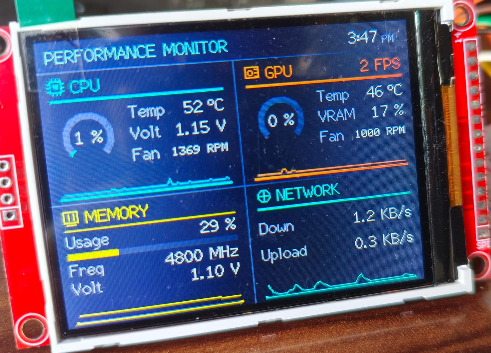
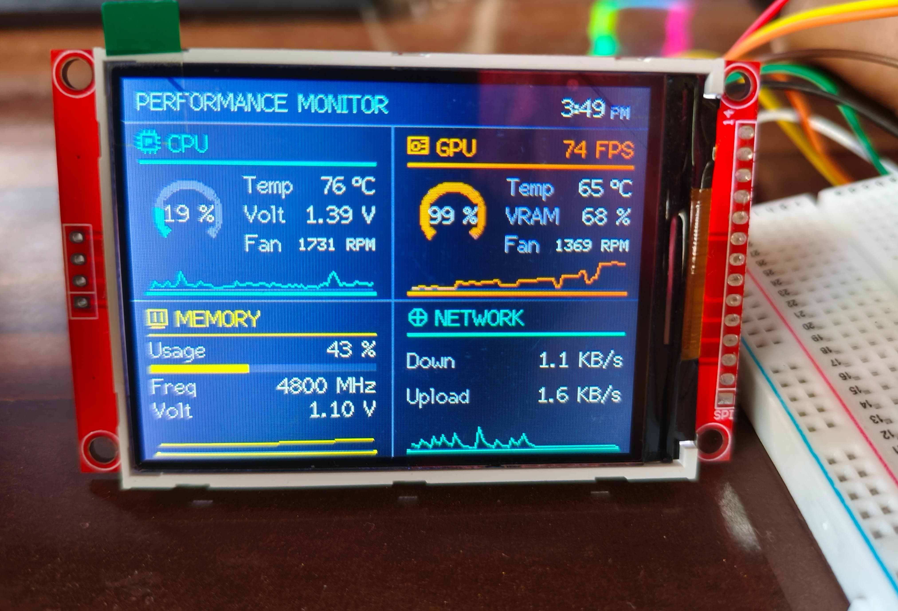
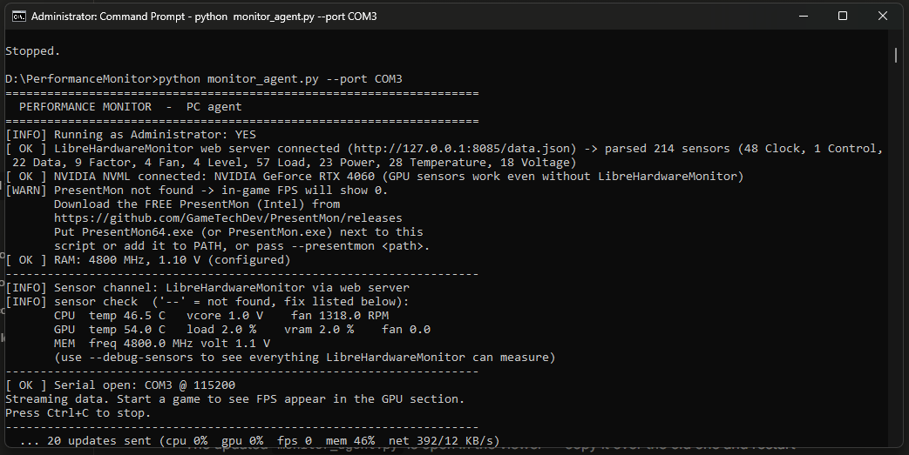
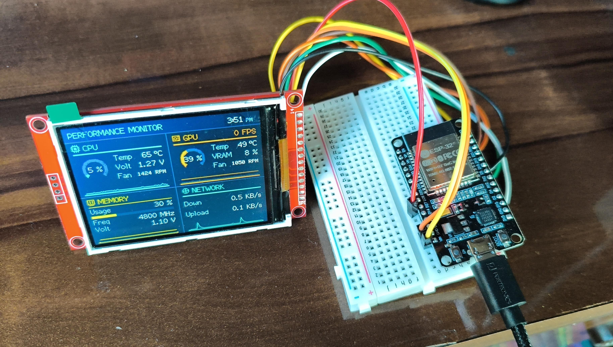

# ⚡ PERFORMANCE MONITOR — ESP32 + 2.8" TFT live PC dashboard

[](https://www.espressif.com/)
[](#1-what-you-need)
[](#4-pc-agent--install--run)
[](LICENSE)

A desktop gadget that shows **real-time stats from your PC** on a 2.8" TFT
display driven by an ESP32 DevKit, connected with nothing but the USB cable:

<p align="center">
  
</p>

```
┌────────────────────────────────────────────────────────────┐
│ PERFORMANCE MONITOR                         10:51 PM       │
├──────────────────────────────┬─────────────────────────────┤
│ ⬡ CPU                ⬡ GPU                     14 FPS     │
│   ╭──╮  Temp  40 °C           ╭──╮  Temp  47 °C            │
│   │2%│  Volt  0.72 V          │14%│  VRAM  16 %            │
│   ╰──╯  1880 RPM              ╰──╯  1043 RPM              │
│   ∿∿∿∿∿∿∿∿∿∿∿∿∿∿∿              ∿∿∿∿∿∿∿∿∿∿∿∿∿∿∿            │
├──────────────────────────────┼─────────────────────────────┤
│ ⬡ MEMORY             ⬡ NETWORK                             │
│   Usage   40 %                 Down    12.4 MB/s           │
│   ▬▬▬▬▭▭▭▭                     Upload  640 KB/s           │
│   Freq   2396 MHz                                           │
│   Volt   1.22 V               ∿∿∿∿∿∿∿∿∿∿∿∿∿∿∿∿∿∿∿∿          │
│   ∿∿∿∿∿∿∿∿∿∿∿∿∿∿∿∿∿∿∿∿                                      │
└──────────────────────────────┴─────────────────────────────┘
```

Everything is measured **live from your PC** (~2 updates per second):

| Feature | How it is done |
|---|---|
| Dark dashboard UI: title + **12-hour clock** (small AM/PM) | header row — no WiFi icon, data comes over USB |
| **FPS counter in the GPU section** for games | `FPS` shown at the GPU quadrant's top-right |
| **Graphs under CPU / GPU / MEMORY / NETWORK** | scrolling sparkline per quadrant (35 s of history) |
| CPU % + ring gauge, Temp, Vcore, cooler fan RPM | LibreHardwareMonitor |
| GPU % + ring gauge, Temp, VRAM %, fan RPM or % | LibreHardwareMonitor / NVIDIA NVML |
| Memory usage % + bar, Freq, Volt | psutil + WMI + LibreHardwareMonitor |
| Network Down / Upload | psutil counters |
| Real-time, always connected to the PC | USB serial, JSON lines @ 115200 baud |

| | |
|---|---|
|  |  |
| The display on a desk | The PC agent at work — 214 live sensors |

See `assets/ui-preview.svg` (what the screen draws) and `assets/wiring.svg`
(how to wire it).

---

## 1. What you need

### Hardware
| # | Part | Notes |
|---|------|-------|
| 1 | **ESP32 DevKit** (ESP32-WROOM-32, "ESP32 Dev Module") | any 30-pin/38-pin DevKit works |
| 2 | **2.8" TFT SPI display, ILI9341, 240x320** | the classic 14-pin board (VCC GND CS RESET DC SDI SCK LED SDO + 5 touch pins) |
| 3 | USB cable **with data lines** (micro-USB or USB-C per your board) | charge-only cables will NOT work |
| 4 | 9× jumper wires (female–female) | 8 are enough (MISO optional) |

> **Do I need any extra components or font files?**
> **No.** No resistors, no level shifters, no SD card, no font files to
> download. Fonts are **built into the TFT_eSPI library** (Font 1 + Font 2).
> Software-side you only install: Arduino IDE + **2 libraries** (TFT_eSPI,
> ArduinoJson) on the ESP32 side, and Python + **3 packages** plus **2 free
> tools** (LibreHardwareMonitor, Intel PresentMon) on the PC side.

### PC software (all free)
| Tool | Purpose | Required? |
|---|---|---|
| [LibreHardwareMonitor](https://github.com/LibreHardwareMonitor/LibreHardwareMonitor/releases) (portable .exe) | CPU temp / Vcore / fan RPM, GPU (any brand), live DRAM voltage | **Yes** for CPU sensor data (agent shows `--` without it) |
| Python package **nvidia-ml-py** (included in requirements.txt) | GPU temp / load / VRAM / fan straight from the NVIDIA driver | Auto — NVIDIA users get full GPU data even **without** LibreHardwareMonitor |
| [Intel PresentMon](https://github.com/GameTechDev/PresentMon/releases) (`PresentMon64.exe`) | in-game **FPS** capture | Yes for FPS (dashboard works without it, FPS shows 0) |
| Python 3.10+ | runs the data agent | **Yes** |
| `pip install -r requirements.txt` (psutil, pyserial, nvidia-ml-py, wmi, pywin32) | agent libraries | **Yes** |

> Works on **Windows 10/11** (full). On Linux the agent still reports CPU/RAM/
> network, but sensor WMI and PresentMon are Windows-only.

---

## 2. Wiring

| TFT pin (label on module) | ESP32 pin | Wire |
|---|---|---|
| **VCC** | **VIN (5V)** ← or 3V3 if your board has no regulator | red |
| **GND** | **GND** | black |
| **LED** (backlight) | **3V3** | orange |
| **SCK / CLK** | **GPIO18** | yellow |
| **SDI / MOSI** | **GPIO23** | green |
| **SDO / MISO** | **GPIO19** *(optional — firmware never reads)* | blue |
| **CS** | **GPIO22** | purple |
| **DC / RS / A0** | **GPIO21** | orange |
| **RESET / RST** | **GPIO27** | white |

* Touch pins (**T_CLK, T_CS, T_DIN, T_DO, T_IRQ**) stay **unconnected**.
* Most 2.8" boards have an onboard 3.3 V regulator + 5 V marking → power from
  **VIN/5V**. The logic pins are 3.3 V and connect directly to the ESP32.
* Full diagram: **`assets/wiring.svg`**.

---

## 3. ESP32 firmware — install & flash

### 3.1 Arduino IDE + ESP32 core
1. Install [Arduino IDE 2.x](https://www.arduino.cc/en/software).
2. `File → Preferences → Additional boards manager URLs`:
   ```
   https://espressif.github.io/arduino-esp32/package_esp32_index.json
   ```
3. `Tools → Board → Boards Manager` → search **esp32** → install
   **esp32 by Espressif Systems**.
4. Select `Tools → Board → esp32 → **ESP32 Dev Module**`, pick your COM port,
   default upload speed 921600 (or 115200 if that fails).

### 3.2 Libraries (`Sketch → Include Library → Manage Libraries`)
1. **TFT_eSPI** by Bodmer — install latest.
2. **ArduinoJson** by Benoit Blanchon — install latest (v6 or v7 both fine).

### 3.3 Configure TFT_eSPI  ← the ONLY step people get wrong
Close the Arduino IDE, then **replace the entire contents** of

```
Documents\Arduino\libraries\TFT_eSPI\User_Setup.h
```

with the file provided in this project:
**`tools/User_Setup.h`**  (copy-paste its full text — it already has the
correct ILI9341 driver, the exact pins from the table above, and the fonts
enabled).

* Leave `User_Setup_Select.h` alone — its line `#include <User_Setup.h>` is
  active by default, which is what we want.
* **ST7789 240x320 display instead of ILI9341?** In that file change one line:
  `#define ILI9341_DRIVER` → `#define ST7789_2_DRIVER`. Everything else stays.

### 3.4 Flash
1. Open `firmware/performance_monitor/performance_monitor.ino`.
2. Plug the ESP32 (with the display wired) into the PC.
3. `Sketch → Upload`. Done — the screen boots to the dashboard in
   "waiting for PC data" state (`--` values).

> If no COM port appears, install the USB-UART driver for your board:
> **CP2102** (Silicon Labs) or **CH340** (WCH) — most DevKits use one of these.

---

## 4. PC agent — install & run

### 4.1 One-time setup
```bat
cd pc_agent
python -m pip install -r requirements.txt
```

1. **LibreHardwareMonitor**: download the portable release, extract, run
   **`LibreHardwareMonitor.exe` as Administrator** and just leave it open
   (it publishes all sensors to WMI). Accept its **PawnIO driver** prompt on
   first run (newer builds) — without it the window shows no sensors. The
   agent auto-retries every few seconds if it is not running yet, and prints
   a **sensor check** at startup so you can immediately see which values are
   live and which show `--`.
   **Important:** the agent must run from an **Administrator** terminal too —
   the LHM WMI namespace only lets admins in. Backup channel: in LHM use
   **Options → Remote Web Server → Run** (port 8085); the agent then reads
   `http://127.0.0.1:8085/data.json` automatically and its log shows which
   channel is live (WMI or web).
2. **PresentMon**: download the console app from
   [GameTechDev/PresentMon releases](https://github.com/GameTechDev/PresentMon/releases)
   (the file is named like `PresentMon-2.6.0-x64.exe`) and put it **next to
   `monitor_agent.py`** — any name starting with `PresentMon` works, no need
   to rename (or add it to PATH / pass `--presentmon <path>`). The agent also
   accepts older 1.x builds automatically. Tip: don't run PresentMon yourself
   while the agent runs — all instances share one capture session and the
   agent takes it over.
3. **NVIDIA GPU**: nothing extra — `nvidia-ml-py` (installed with
   requirements.txt) reads temp/load/VRAM/fan directly from the NVIDIA driver.
   AMD/Intel GPUs need LibreHardwareMonitor for GPU data.

### 4.2 Start it
Open **Command Prompt / PowerShell AS ADMINISTRATOR** — required twice over:
PresentMon captures frames through ETW (needs elevation), and reading the
LibreHardwareMonitor WMI data needs admin rights too (the startup log shows
`Running as Administrator: YES/NO`):

```bat
cd pc_agent
python monitor_agent.py
```

The agent:
* auto-detects the ESP32 COM port (use `--port COM5` to force one),
* starts PresentMon for FPS,
* streams one JSON line per update (~2 Hz) to the display.

Useful flags:

| Flag | Meaning |
|---|---|
| `--port COM5` | explicit serial port (`/dev/ttyUSB0` on Linux) |
| `--interval 0.25` | faster updates (default 0.5 s) |
| `--presentmon C:\path\PresentMon64.exe` | explicit PresentMon path |
| `--presentmon off` | disable FPS capture |
| `--debug-sensors` | list every sensor LibreHardwareMonitor exposes (find missing names) |
| `--dry-run` | print the JSON lines to the console instead of sending |
| `--quiet` | less console chatter |

**Close the Arduino Serial Monitor while the agent runs** — a serial port can
only be open in one program at a time.

### 4.3 Start everything automatically with Windows (optional)

Goal: after every reboot the display lights up by itself — LHM, PresentMon and
the agent all running, no clicks.

1. **PresentMon** (in-game FPS): download
   [PresentMon](https://github.com/GameTechDev/PresentMon/releases) and put
   the exe (e.g. `PresentMon-2.6.0-x64.exe`) **next to `monitor_agent.py`**
   (e.g. `D:\PerformanceMonitor\pc_agent\`). The agent finds any
   `PresentMon*.exe` automatically.
2. **LibreHardwareMonitor** — one-time ticks in its **Options** menu, no Task
   Scheduler needed:
   * **Options → Run On Windows Startup** ✔
   * **Options → Start Minimized** ✔ and **Minimize To Tray** ✔
   * **Options → Remote Web Server → Run** ✔ (port 8085)

   Keep the "run this program as administrator" compatibility setting you
   already set — LHM now starts with Windows, sits in the tray and keeps its
   web server running.
3. **The agent** — Task Scheduler (it needs admin rights; a plain Startup
   shortcut cannot elevate):
   1. `Win+R` → `taskschd.msc` → **Action → Create Task…** (not "Basic Task")
   2. **General**: name `Performance Monitor Agent`; choose **Run only when
      user is logged on**; check **Run with highest privileges**.
   3. **Triggers**: New… → **At log on** → OK.
   4. **Actions**: New… → *Start a program*:
      * **Program**: full path to `pythonw.exe` — find it with `where python`
        in a command prompt; `pythonw.exe` sits in the same folder, e.g.
        `C:\Users\<you>\AppData\Local\Programs\Python\Python312\pythonw.exe`
      * **Arguments**: `"D:\PerformanceMonitor\pc_agent\monitor_agent.py"`
        (add `--port COM3` to pin the port, or leave it out to auto-detect)
      * **Start in**: `D:\PerformanceMonitor\pc_agent`
   5. **Settings**: "Stop the task if it runs longer than" → **Do not stop**;
      "If the task is already running" → **Do not start a new instance**.
      OK (enter the admin password if asked).
4. **Test**: select the task → **Run**. Within a few seconds the display shows
   live data.

`pythonw.exe` runs silently (no console). To watch the sensor log for
debugging, run `python monitor_agent.py --port COM3` manually in a terminal.

---

## 5. Serial protocol (for customization)

One JSON object per line, 115200 baud, `\n` terminated:

| Key | Meaning | Example |
|---|---|---|
| `cpu` | CPU usage % | `2` |
| `ct` | CPU temp °C | `40` |
| `cv` | CPU Vcore V | `0.72` |
| `cf` | CPU fan RPM | `1880` |
| `gpu` | GPU usage % | `14` |
| `fps` | game FPS | `144` |
| `gt` | GPU temp °C | `47` |
| `vram` | VRAM usage % | `16` |
| `gf` | GPU fan RPM | `1043` |
| `mem` | RAM usage % | `40` |
| `mf` | RAM frequency MHz | `2396` |
| `mv` | RAM voltage V | `1.22` |
| `down` | download KB/s | `12697.6` |
| `up` | upload KB/s | `640` |
| `gfu` | GPU fan unit: `0`=RPM (LHM), `1`=percent (NVIDIA NVML) | `0` |
| `h`,`m`,`ap` | hour (1–12), minute, 0=AM 1=PM | `10`,`51`,`1` |

**A sensor value of `-1` means "not available"** — the display shows `--`
instead of a fake number (so a missing sensor can never look like "0 °C").

Example line:
```json
{"cpu":2,"ct":40,"cv":0.72,"cf":1880,"gpu":14,"fps":144,"gt":47,"vram":16,"gf":1043,"gfu":0,"mem":40,"mf":2396,"mv":1.22,"down":12697.6,"up":640,"h":10,"m":51,"ap":1}
```

Both sides are plain text — you can add fields by extending
`monitor_agent.py` (build the packet) and `parseLine()` in the `.ino`.

---

## 6. Customization cheat-sheet (in `performance_monitor.ino`)

| Want… | Change |
|---|---|
| Colours | the `C_*` `#define`s (RGB565 values, comments show the RGB) |
| Longer/shorter graphs | `HIST_N` (samples) + `SAMPLE_PX` (pixels per sample) |
| Faster updates | `--interval` on the agent (e.g. `0.25`) |
| Different layout/sizes | the geometry `#define`s at the top (`QW`, `ROW*_Y`, `GAUGE_*`, `GRAPH_*`) |
| Fahrenheit | convert in the agent (`ct*9/5+32`) and change "C"→"F" in `drawTempRight` |
| MB/s always | edit `fmtNet()` |
| ST7789 display | one line in `tools/User_Setup.h` (see §3.3) |

The screen is drawn into a full-frame sprite (RAM buffer) and pushed in one
shot → **no flicker, no tearing**.

---

## 7. Troubleshooting

| Symptom | Fix |
|---|---|
| **`OUT OF MEMORY` on the screen** | Old symptom from the first firmware version (it used a 153 KB frame buffer). **Re-upload `performance_monitor.ino`** — the current firmware draws directly to the display and needs almost no RAM, so this can no longer happen.  |
| Compile error: **`'VSPI_HOST' was not declared in this scope`** (in `TFT_eSPI_ESP32.c`) | Your ESP32 core is the new 3.x. Paste the 6-line compatibility block from `tools/User_Setup.h` at the **top** of `Documents\Arduino\libraries\TFT_eSPI\User_Setup.h` (before `#define ILI9341_DRIVER`), then recompile. Alternatives: Boards Manager → esp32 → select **2.0.17** (works with any TFT_eSPI), or update TFT_eSPI to ≥ 2.5.43 and re-paste User_Setup.h. |
| White / garbage / rainbow screen | Wrong driver or pins → re-check `User_Setup.h` matches §2. Try `SPI_FREQUENCY 27000000`. Re-solder/seat wires. |
| Screen lit but nothing drawn | CS/DC/RST swapped — most common mistake. CS=22, DC=21, RST=27. |
| No COM port | Install CP2102 or CH340 USB driver; try another cable (must be a **data** cable). |
| `Cannot open COMx` from the agent | Close Arduino **Serial Monitor** / any other program using the port. |
| Values show `--` forever | Agent not running or wrong port → run `python monitor_agent.py --dry-run` to verify it collects data, then check `--port`. |
| Temps/Vcore/fans show `--` | **LHM is not running / not elevated, or the AGENT terminal is not elevated.** Run LHM as Admin (accept its PawnIO prompt) **and** run the agent from an Administrator terminal — LHM's WMI namespace is admin-only. Backup: LHM **Options → Remote Web Server → Run** (port 8085) — the agent picks that channel up automatically and prints `parsed N sensors (x Temperature, y Voltage, z Fan)` on connect. If y/z = 0, open LHM's own window: no Voltages/Fans group there means the board's Super I/O chip is unsupported and those values cannot be read. The startup log shows the exact WMI/web error text; `--debug-sensors` lists everything LHM measures. |
| GPU data shows `--` (NVIDIA) | `pip install nvidia-ml-py` (already in requirements.txt). For AMD/Intel GPUs, GPU data comes from LibreHardwareMonitor instead. |
| Numbers were overlapping into white blobs / the graph was a solid block | Fixed in this version (the screen buffer is now cleared every frame) — **re-upload `performance_monitor.ino`** and restart the agent. |
| GPU fan shows a % instead of RPM | Normal on NVIDIA fallback (NVML reports percent) — with LibreHardwareMonitor running you get real RPM. |
| FPS always 0 | 1) Run the agent **as Administrator** (ETW). 2) PresentMon not found → put the downloaded `PresentMon-*-x64.exe` next to `monitor_agent.py` — any `PresentMon*.exe` name works. 3) **Close any manually-opened PresentMon window** — all instances share one capture session (the agent takes it over). 4) Start a game — desktop idles show 0. |
| FPS shows something but not my game | The display shows the **most active** app. Streaming/overlay apps (OBS is already ignored) can compete — add their exe names to `FPSMonitor.IGNORE_APPS`. |
| RAM Volt shows 1.20/1.35 constant | Your board doesn't expose a live DRAM voltage sensor, so the agent falls back to the memory's *configured* voltage from SMBIOS — still correct in practice. |
| Display freezes when game starts | Use a good USB cable/port; lower `--interval` pressure with default 0.5 s; make sure the agent console isn't spamming output (`--quiet`). |

---

## 8. File map

```
performance-monitor/
├── README.md                          ← you are here
├── firmware/
│   └── performance_monitor/
│       └── performance_monitor.ino    ← ESP32 sketch (flash this)
├── pc_agent/
│   ├── monitor_agent.py               ← PC data collector + FPS + serial TX
│   └── requirements.txt               ← pip packages
├── tools/
│   └── User_Setup.h                   ← paste into TFT_eSPI library
├── assets/
│   ├── wiring.svg                     ← wiring diagram
│   ├── ui-preview.svg                 ← exact UI layout preview
│   └── photos/                        ← photos & screenshots used in this README
├── LICENSE                            ← MIT
└── .gitignore
```

Enjoy your build! 🎮📈
